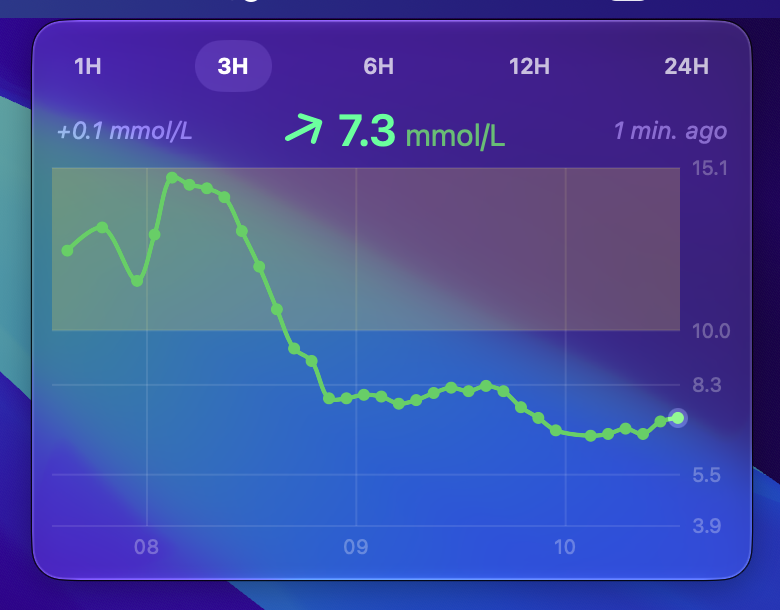

# Glucose

A macOS menu bar app that shows your latest Dexcom reading in mmol/L. Click it
to see a chart of the last 1 to 24 hours.



It reads from Dexcom Share, the same service the Dexcom follow app uses, so
Share must be turned on in the Dexcom app.

## Requirements

- macOS 14 or later
- Xcode 16 or later
- A Dexcom Share account

## Build and run

```sh
make run
```

This builds into `./build`, quits any running copy and opens the new build. You
can also open `Glucose.xcodeproj` in Xcode and press Run. The app has no Dock
icon.

## Setup

1. Click the menu bar item and choose **Open Settings…**
2. Pick your region (Outside US or United States) and enter your Dexcom Share
   username and password.
3. Click **Save & Connect**.

The app polls for new readings every minute by default. You can change the
interval in Settings. It stores the credentials in the macOS Keychain under the
service `se.kalasjocke.glucose.dexcom`. To remove them:

```sh
security delete-generic-password -s se.kalasjocke.glucose.dexcom
```
